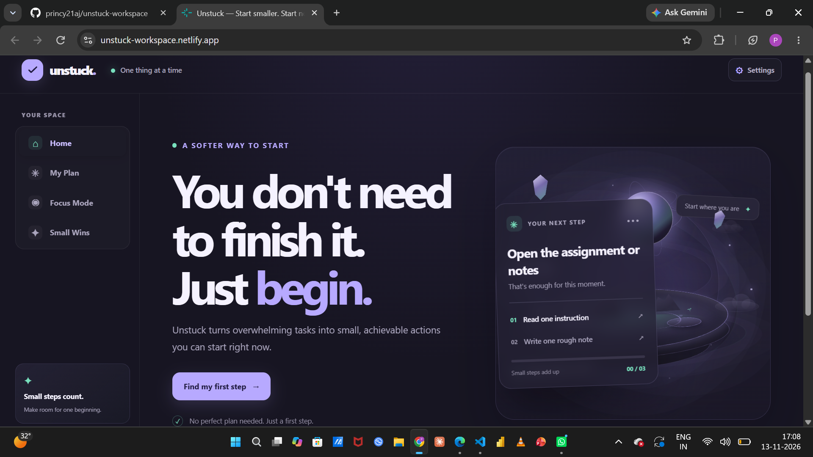
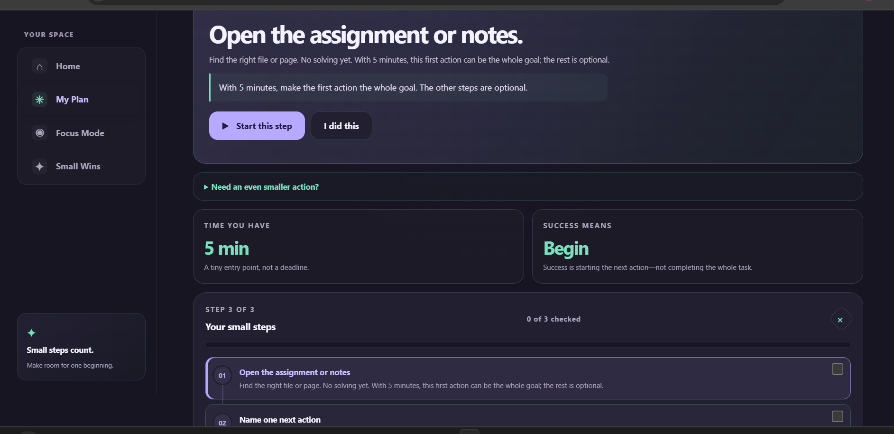
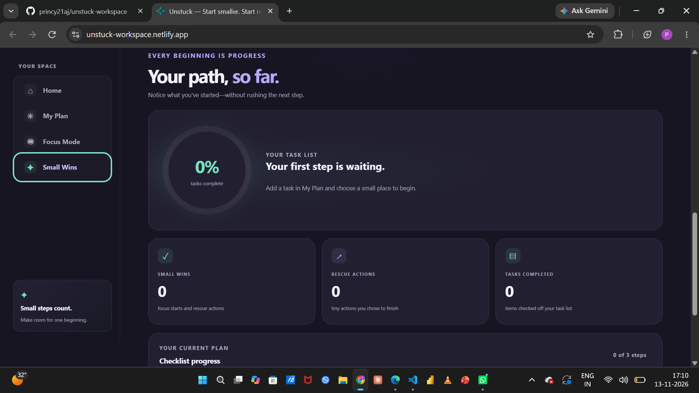

# Unstuck 🌿

**Start smaller. Start now.**

Unstuck helps you begin a task when it feels too big. Instead of a long to-do list, it gives you one tiny first step and a small plan you can stop after any step.

**Live demo:** https://unstuck-workspace.netlify.app

Built for the Hyperbloom October UI/UX and Web Design Hackathon.

## Screenshots

## What it does

- **Tiny first step:** pick a task type (study, coding, writing, research, admin, other), the time you have, and your energy level (low, medium, high). It gives you a 3-step plan with one small first action.
- **Adapts to what is blocking you:** choose a barrier such as "I don't know how to start", "It feels too big", "No energy", "Afraid it won't be good", "Distracted" or "Keep postponing", and the steps change to match.
- **Focus mode:** a calm timer (2 to 25 minutes) for one step at a time. It pauses when you switch screens.
- **20-second rescue:** an almost effortless action to break the delay, with a short countdown.
- **My Plan:** a task list and a step checklist with progress.
- **Small Wins:** a log of every start and completed plan, plus a progress dashboard.
- **Settings:** default time, energy and barrier, and a reduced-motion option.
- **Copy plan:** copy your plan as plain text.

Everything is saved in your browser (localStorage). There is no backend, no account and no tracking.

## Built with

HTML, CSS and vanilla JavaScript. No frameworks and no build step.

## Accessibility

Keyboard navigation, screen-reader labels, visible focus outlines, and a reduced-motion setting (it also respects the system setting).

## Run it locally

1. Download or clone this repository.
2. Open `index.html` in your browser.

## Project files

- `index.html`: page structure
- `style.css`: styling
- `script.js`: app logic, plan generation and saved progress

## What I learned

Designing for people who feel stuck means removing pressure. Every screen says that starting counts, and stopping is allowed.

## Author

Amal Princy J